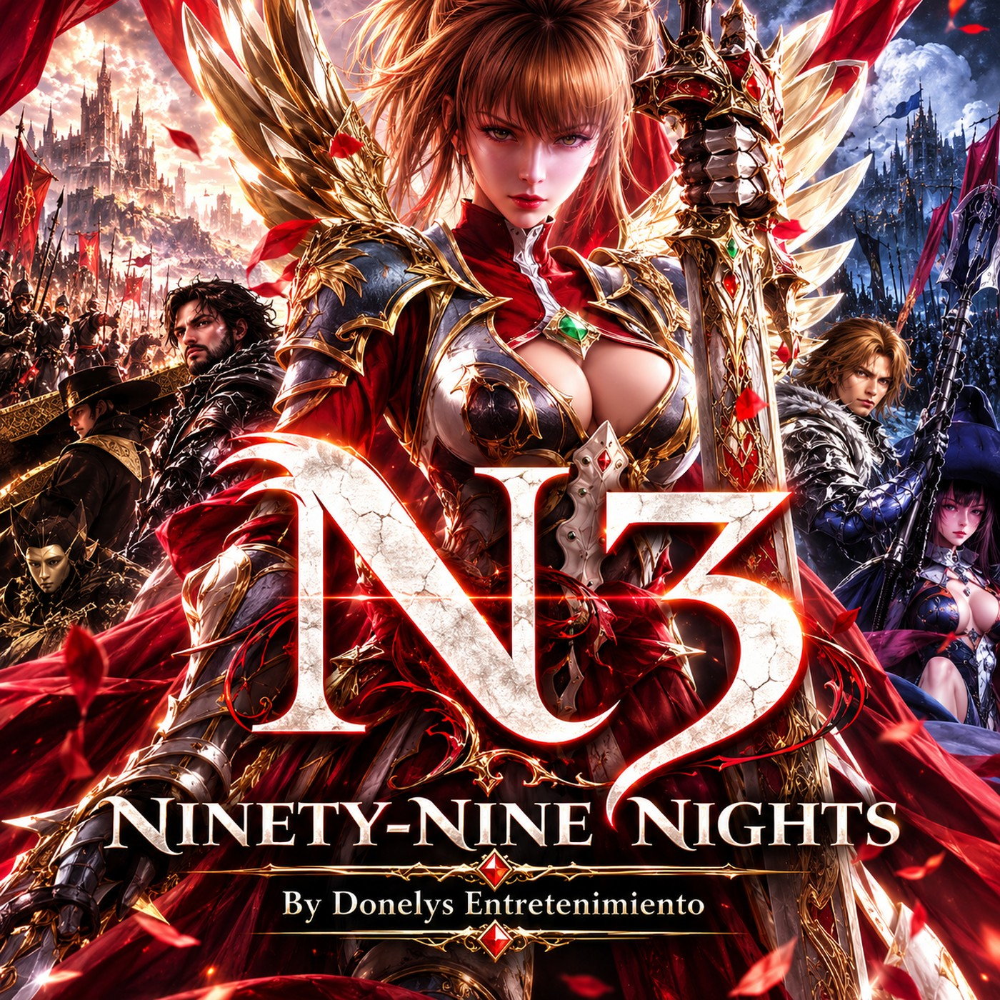

  

<h1 align="center">DONELYS · N3: NINETY-NINE NIGHTS</h1>

<b>Edición para Windows · Windows edition</b>

  <a href="#español">Español</a> ·
  <a href="#english">English</a> ·
  <a href="https://github.com/donelysentretenimiento/Donelys-N3recomp/releases/latest">Descargas · Downloads</a> ·
  <a href="DONELYS-INGAME.md">Menú y diagnóstico · Menu and diagnostics</a> ·
  <a href="THIRD_PARTY-NOTICES.md">Licencias · Licenses</a>

  
  
  
  

> **Este repositorio no contiene el juego.** No incluye ISO, `default.xex`, audio, textos extraídos ni claves. Necesitas tu propia copia legítima de *N3: Ninety-Nine Nights* (PAL / USA-Europa).
> **This repository does not contain the game.** No ISO, `default.xex`, audio, extracted text or keys. You need your own legitimate copy of *N3: Ninety-Nine Nights* (PAL / USA-Europe).

---

## Español

### Qué es
DONELYS · N3 es una edición independiente del recompilador nativo de *N3: Ninety-Nine Nights* para Windows. Parte de [N3 Recompiled](https://github.com/WK2D/N3-Ninety-Nine-Nights-Recomp) de WK2D y añade un **launcher propio**, un **menú dentro del juego en español**, la **selección real del idioma de los textos**, las **voces japonesas** sobre la edición PAL y herramientas para **medir el rendimiento**.

### Qué cambia respecto a la versión original
| Antes | Ahora |
|---|---|
| El idioma de los textos quedaba fijo en inglés y los acentos salían como una «X roja» | Eliges español, inglés, francés, alemán o italiano (`n3_text_language`), con los acentos correctos y sin tocar ningún archivo del juego |
| Solo voces en inglés en la edición PAL | Voces japonesas originales desde tu ISO japonesa o el UNDUB, sin copiar 5,8 GB (enlaces duros) y con comprobación de compatibilidad |
| Ajustes gráficos solo desde un menú del propio juego o editando `n3.toml` | Launcher con importación de ISO, ajustes reales y copia de seguridad, y un **menú en el juego (F5)** que los aplica al momento |
| Sin forma de saber por qué algo va lento | Registro de FPS con media, P95, P99 y tirones (`frame_pacing_trace`) y una sonda que mide el limitador sin abrir el juego |
| Ventana con título y barra genéricos | Título, icono y colores propios; modo sin borde opcional |

### Cómo jugar
1. Descarga el **ZIP portátil** de la [última release](https://github.com/donelysentretenimiento/Donelys-N3recomp/releases/latest) y descomprímelo entero en una carpeta.
2. Abre `Iniciar DONELYS N3.cmd`.
3. La primera vez, el launcher te pide tu ISO PAL o la carpeta ya extraída. Comprueba la versión por la huella SHA-256 de su ejecutable y configura las rutas solo.
4. Elige idioma, voces y gráficos en *Ajustes* y pulsa **JUGAR**. En el juego, **F5** abre el menú DONELYS y **F4** el panel técnico del SDK.

No necesitas Visual Studio, CMake ni herramientas de desarrollo. Requisitos: Windows 10/11 de 64 bits y una GPU compatible con Direct3D 12.

### Estado
Es una **vista previa**. Probado en Ryzen 7 9800X3D · RTX 5090 · 64 GB · Windows 11; otros equipos no están validados.

| Comprobado | Sin comprobar o con límites |
|---|---|
| Menú F5, idioma (se aplica, se guarda y persiste tras reiniciar), Esc | Pantalla completa desde el menú F5 y mando |
| Primer arranque desde una carpeta limpia con el ZIP portátil | Con el menú abierto, el teclado también llega al juego (límite del SDK) |
| Una misión real: 187 de 199 ventanas de 2 s a 58–60 FPS | Voces japonesas audibles en todas las misiones |
| 51 pruebas nativas y 8 del launcher | Texto japonés sobre la PAL y UNDUB como edición propia: no viables |

### Documentación
[Menú, perfiles y diagnóstico](DONELYS-INGAME.md) · [Instalación](launcher/docs/es/instalacion.md) · [Compatibilidad](launcher/docs/es/compatibilidad.md) · [Cómo funciona](launcher/docs/es/como-funciona.md) · [Gráficos y F4](launcher/docs/es/graficos-y-f4.md) · [Limitaciones](launcher/docs/es/limitaciones.md) · [Compilar desde el código](launcher/docs/es/compilar.md)

### Compilar desde el código
El juego se compila con `tools/bootstrap.ps1` y `tools/build.ps1` y necesita tu propia copia del juego. La guía de desarrollo heredada del proyecto base se conserva en [README.upstream.md](README.upstream.md); las particularidades de esta edición están en [DONELYS-INGAME.md](DONELYS-INGAME.md).

### Licencia, créditos y marcas
**El repositorio no es GPL en su conjunto.** Lo son los módulos propios de Donelys Entretenimiento (launcher, menú, idioma integrado, diagnóstico, pruebas y documentación), © 2026, GPL-3.0-or-later; el texto está en [`LICENSES/GPL-3.0-DONELYS.txt`](LICENSES/GPL-3.0-DONELYS.txt) y en [`launcher/LICENSE`](launcher/LICENSE). El resto conserva su licencia, detallada en [THIRD_PARTY-NOTICES.md](THIRD_PARTY-NOTICES.md):

- **N3 Recompiled** — WK2D. Su repositorio **no declara licencia**: se mantiene su autoría y esta edición se publica bajo responsabilidad de Donelys Entretenimiento; se retirará si su autor lo solicita.
- **ReXGlue SDK** — Tom Clay y colaboradores (BSD 3-Clause), derivado en parte de **Xenia**. También Dear ImGui y toml++ (MIT), Electron/Chromium, y las tipografías Cinzel y Cormorant Garamond (SIL OFL 1.1).
- ***N3: Ninety-Nine Nights*** pertenece a sus titulares; este proyecto no está afiliado a ellos. Véase [`launcher/TRADEMARKS.md`](launcher/TRADEMARKS.md).
- La portada, el fondo y el icono son arte de Donelys Entretenimiento, todos los derechos reservados.

---

## English

### What it is
DONELYS · N3 is an independent Windows edition of the native recompilation of *N3: Ninety-Nine Nights*. It starts from WK2D's [N3 Recompiled](https://github.com/WK2D/N3-Ninety-Nine-Nights-Recomp) and adds **its own launcher**, an **in-game menu**, **real text-language selection**, **Japanese voices** on top of the PAL edition and tools to **measure performance**.

### What changes compared with the original
| Before | Now |
|---|---|
| The text language was stuck on English and accented letters showed as a "red X" | Pick Spanish, English, French, German or Italian (`n3_text_language`), with correct accents and without touching any game file |
| English voices only on the PAL edition | Original Japanese voices from your Japanese ISO or the UNDUB, without copying 5.8 GB (hard links) and with a compatibility check |
| Graphics settings only from the game's own menu or by editing `n3.toml` | A launcher with ISO import, real settings and backups, plus an **in-game menu (F5)** that applies them instantly |
| No way to tell why something runs slowly | FPS logging with mean, P95, P99 and hitches (`frame_pacing_trace`) and a probe that measures the limiter without starting the game |
| Generic window title and caption | Own title, icon and colours; optional borderless mode |

### How to play
1. Download the **portable ZIP** from the [latest release](https://github.com/donelysentretenimiento/Donelys-N3recomp/releases/latest) and extract it entirely into a folder.
2. Open `Iniciar DONELYS N3.cmd`.
3. On first start the launcher asks for your PAL ISO or the already extracted folder. It checks the version by the SHA-256 of its executable and sets the paths up by itself.
4. Pick language, voices and graphics under *Ajustes* (Settings) and press **JUGAR** (Play). In game, **F5** opens the DONELYS menu and **F4** the SDK's technical panel.

You do not need Visual Studio, CMake or any development tool. Requirements: 64-bit Windows 10/11 and a Direct3D 12 capable GPU.

### Status
This is a **preview**. Tested on Ryzen 7 9800X3D · RTX 5090 · 64 GB · Windows 11; other systems are not validated.

| Checked | Unchecked or limited |
|---|---|
| F5 menu, language (applies, saves and persists after a restart), Esc | Fullscreen from the F5 menu and gamepad |
| First start from a clean folder with the portable ZIP | With the menu open, the keyboard also reaches the game (SDK limit) |
| One real mission: 187 of 199 two-second windows at 58–60 FPS | Audible Japanese voices in every mission |
| 51 native tests and 8 launcher tests | Japanese text on the PAL and the UNDUB as its own edition: not feasible |

### Documentation
[Menu, presets and diagnostics](DONELYS-INGAME.md) · [Installation](launcher/docs/en/installation.md) · [Compatibility](launcher/docs/en/compatibility.md) · [How it works](launcher/docs/en/how-it-works.md) · [Graphics and F4](launcher/docs/en/graphics-and-f4.md) · [Limitations](launcher/docs/en/limitations.md) · [Building from source](launcher/docs/en/building.md)

### Building from source
The game is built with `tools/bootstrap.ps1` and `tools/build.ps1` and needs your own copy of the game. The development guide inherited from the base project is kept in [README.upstream.md](README.upstream.md); this edition's specifics are in [DONELYS-INGAME.md](DONELYS-INGAME.md).

### License, credits and trademarks
**The repository is not GPL as a whole.** Donelys Entretenimiento's own modules (launcher, menu, built-in language, diagnostics, tests and documentation) are © 2026, GPL-3.0-or-later; the text is in [`LICENSES/GPL-3.0-DONELYS.txt`](LICENSES/GPL-3.0-DONELYS.txt) and [`launcher/LICENSE`](launcher/LICENSE). Everything else keeps its own license, detailed in [THIRD_PARTY-NOTICES.md](THIRD_PARTY-NOTICES.md):

- **N3 Recompiled** — WK2D. Its repository **declares no license**: its authorship is kept and this edition is published on Donelys Entretenimiento's responsibility; it will be withdrawn if its author asks.
- **ReXGlue SDK** — Tom Clay and contributors (BSD 3-Clause), partly derived from **Xenia**. Also Dear ImGui and toml++ (MIT), Electron/Chromium, and the Cinzel and Cormorant Garamond typefaces (SIL OFL 1.1).
- ***N3: Ninety-Nine Nights*** belongs to its rights holders; this project is not affiliated with them. See [`launcher/TRADEMARKS.md`](launcher/TRADEMARKS.md).
- The cover, background and icon are Donelys Entretenimiento artwork, all rights reserved.
